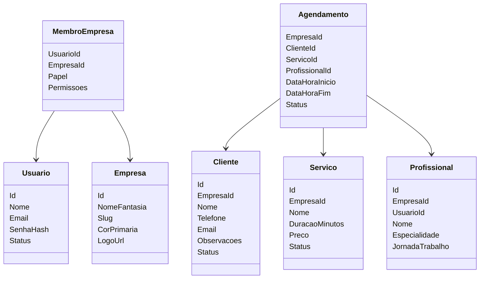
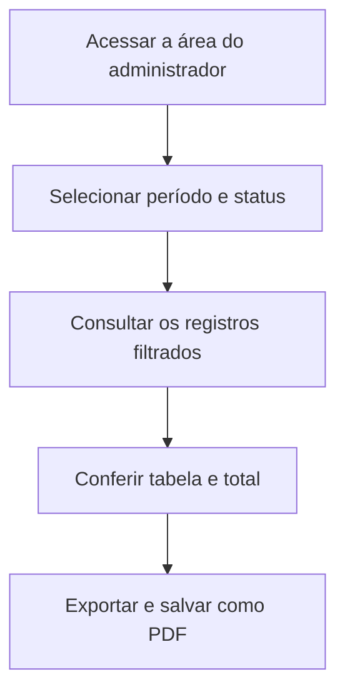

# Zlora — Plataforma Web de Gestão e Agendamento para Estabelecimentos de Beleza e Estética

**Projeto Interdisciplinar — Fatec Jahu / Centro Paula Souza (2026)**

**Curso:** Tecnologia em Desenvolvimento de Software Multiplataforma  

**Autores:** Evellyn Santana Marinho, Rafael Henrique Biliasi e Tainara Santos  

**Local:** Jaú, SP

> Documentação convertida do PDF acadêmico original para Markdown, mantendo o conteúdo e adaptando quadros e diagramas para o GitHub. As funcionalidades descritas são requisitos ou propostas e não representam, necessariamente, funcionalidades já implementadas.

## Sumário

- [1. Introdução](#1-introducao)

- [2. Fundamentação da solução](#2-fundamentacao-da-solucao)

- [3. Estudo de viabilidade](#3-estudo-de-viabilidade)

- [4. Metodologia](#4-metodologia)

- [5. Documento de requisitos](#5-documento-de-requisitos)

- [6. Modelagem de casos de uso](#6-modelagem-de-casos-de-uso)

- [7. Regras de negócio](#7-regras-de-negocio)

- [8. Arquitetura e modelagem de dados](#8-arquitetura-e-modelagem-de-dados)

- [9. Design e organização da interface](#9-design-e-organizacao-da-interface)

- [10. Considerações finais](#10-consideracoes-finais)

- [Referências](#referencias)

## Resumo

O presente trabalho apresenta o Zlora, uma plataforma web voltada à gestão e ao agendamento de serviços em estabelecimentos de beleza e estética. O problema abordado consiste na organização fragmentada de informações de clientes, profissionais, serviços e horários, que dificulta o acompanhamento dos atendimentos e a consulta de registros. O objetivo geral é estruturar uma solução que reúna esses processos em um ambiente digital com acesso por perfil e personalização por estabelecimento. O desenvolvimento articula levantamento de requisitos, modelagem da solução, organização dos dados e construção da interface e da aplicação servidora. A arquitetura utiliza React e JavaScript no frontend, C# com ASP.NET Core na API e MongoDB na persistência. A documentação descreve os requisitos funcionais e não funcionais, os atores, os casos de uso, as regras de negócio e as principais entidades do domínio. Também apresenta a organização visual do sistema e o fluxo de geração do relatório de agendamentos, com filtros por período e situação e exportação por meio da impressão do navegador. A proposta busca apoiar a organização administrativa e ampliar a disponibilidade das informações necessárias ao atendimento. O projeto integra conhecimentos de desenvolvimento web, engenharia de software e banco de dados, estabelecendo uma base documentada para a manutenção e a evolução da solução.

**Palavras-chave:** gestão de serviços; agendamento; aplicação web; banco de dados; relatórios.

## Abstract

This work presents Zlora, a web platform for managing and scheduling services in beauty and aesthetic businesses. The problem addressed is the fragmented organization of customer, professional, service and appointment information, which makes service monitoring and record retrieval more difficult. The main objective is to design a solution that brings these processes together in a digital environment with role-based access and business-specific customization. Development combines requirements elicitation, solution modeling, data organization and the construction of the user interface and server application. The architecture uses React and JavaScript for the frontend, C# with ASP.NET Core for the API, and MongoDB for persistence. The documentation describes functional and non-functional requirements, actors, use cases, business rules and the main domain entities. It also presents the visual organization of the system and the appointment reporting workflow, including date and status filters and export through the browser print function. The proposal aims to support administrative organization and improve access to information required for customer service. The project brings together web development, software engineering and database concepts, providing a documented foundation for maintaining and evolving the solution.

**Keywords:** service management; scheduling; web application; database; reports.

## 1 INTRODUÇÃO

A organização de estabelecimentos de beleza e estética envolve atividades que precisam ser coordenadas: cadastro de clientes, definição de serviços, disponibilidade dos profissionais e acompanhamento dos horários reservados. Quando essas informações são distribuídas entre agendas físicas, planilhas e mensagens, sua consulta depende da combinação de registros e da comunicação constante entre as pessoas responsáveis pelo atendimento. O Zlora é desenvolvido nesse contexto como uma plataforma web de gestão e agendamento. A solução reúne informações operacionais em uma aplicação com áreas destinadas ao administrador, ao profissional e ao cliente. A proposta contempla a personalização do estabelecimento e a apresentação de seu catálogo de serviços, relacionando a divulgação do negócio à organização de sua rotina.

### 1.1 Tema e delimitação

O tema do projeto é o desenvolvimento de uma aplicação web para gestão de serviços e agendamentos no setor de beleza e estética. O público-alvo compreende salões de beleza, barbearias, clínicas de estética, manicures e profissionais autônomos que trabalham com atendimento por horário. O domínio central envolve usuários, empresas, clientes, profissionais, serviços e agendamentos. A documentação trata da especificação da solução e da organização técnica de seus módulos, tomando como base o planejamento do projeto (Equipe Zlora, 2026b). Os requisitos descrevem o comportamento esperado do sistema, enquanto a arquitetura apresenta a distribuição de responsabilidades entre interface, aplicação servidora e persistência.

### 1.2 Problema

A fragmentação dos registros dificulta identificar quais serviços foram solicitados, quem realizará cada atendimento e quais horários estão ocupados. Também torna mais trabalhosa a consulta do histórico, pois os dados podem aparecer em formatos e locais diferentes. Para o administrador, essa situação aumenta a dependência de controles paralelos; para o cliente, pode dificultar o acesso às informações do agendamento. Diante desse contexto, formula-se a seguinte questão: como organizar uma plataforma web que integre cadastros, agenda e consulta de atendimentos, respeitando os diferentes perfis de acesso e permitindo a apresentação das informações em relatórios?

### 1.3 Objetivos

O objetivo geral é desenvolver uma plataforma web que centralize a gestão de clientes, profissionais, serviços e agendamentos, apoiando a organização dos estabelecimentos de beleza e estética. Como objetivos específicos, definem-se: organizar os cadastros necessários ao atendimento; permitir a escolha de serviços e profissionais; estruturar a consulta de agenda conforme o perfil de acesso; oferecer personalização visual por estabelecimento; reunir indicadores administrativos; e permitir a consulta e a exportação do histórico de agendamentos em formato PDF.

### 1.4 Justificativa

A relevância do projeto está na relação entre a organização das informações e a execução das atividades de atendimento. Uma base de dados compartilhada pela aplicação permite relacionar clientes, profissionais e serviços sem repetir esses registros em cada consulta. O histórico documentado também contribui para a recuperação das informações e para a apresentação dos atendimentos realizados ou programados. No contexto acadêmico, o projeto favorece a aplicação integrada de conteúdos de desenvolvimento web, programação orientada a objetos, persistência de dados e engenharia de software. A separação entre frontend e backend permite compreender tanto a experiência do usuário quanto o tratamento das requisições e a organização dos dados.

## 2 FUNDAMENTAÇÃO DA SOLUÇÃO

### 2.1 Aplicações web e integração de processos

Uma aplicação web permite que a interface seja acessada pelo navegador e que as operações sejam processadas por um servidor. No Zlora, essa organização estabelece um ponto de comunicação entre os diferentes perfis de usuário e os registros do estabelecimento. O cadastro de um serviço, por exemplo, fornece informações utilizadas no agendamento, na agenda e no relatório.

A integração é orientada por identificadores que relacionam as entidades do domínio. Dessa forma, a agenda não precisa manter um cadastro independente de clientes e serviços. Cada consulta pode recuperar os dados relacionados ao atendimento e apresentá-los de acordo com a finalidade da tela.

### 2.2 Construção de interfaces com React

O React organiza interfaces por componentes, que reúnem estrutura visual e comportamento. Sua documentação apresenta o uso de componentes, eventos, estados e renderização de listas como elementos centrais para a construção das páginas (React, [s.d.]). No projeto, esses conceitos são utilizados em formulários, tabelas, navegação e exibição de dados recebidos da API. O JavaScript controla as interações e o tratamento das respostas, enquanto o HTML e o CSS estruturam e apresentam o conteúdo. O Vite compõe o ambiente de desenvolvimento do frontend, e o React Router organiza a navegação entre áreas públicas e páginas vinculadas aos perfis de usuário.

### 2.3 API e separação de responsabilidades

O ASP.NET Core oferece recursos para a construção de aplicações web e interfaces de programação de aplicações, além de mecanismos de configuração, autenticação e autorização (Microsoft, [s.d.]). No Zlora, a API é desenvolvida em C# e organiza as operações em controllers relacionados aos cadastros e processos do domínio. A interface envia requisições pelo protocolo HTTP e recebe respostas em JavaScript Object Notation (JSON). O servidor interpreta os dados, executa validações e acessa a persistência. Essa separação permite concentrar as regras de acesso e de consistência no backend, independentemente da forma como as informações são exibidas ao usuário.

### 2.4 Persistência orientada a documentos

O MongoDB armazena registros como documentos agrupados em coleções. Cada banco reúne uma ou mais coleções, nas quais são organizados os dados da aplicação (MongoDB, [s.d.]). Essa estrutura é utilizada no Zlora para representar as entidades de usuários, empresas, clientes, profissionais, serviços e agendamentos. Os modelos em C# definem os campos utilizados pela aplicação e seu mapeamento para os documentos. Os identificadores permitem associar os registros, enquanto campos de criação, alteração e situação apoiam a organização das consultas. A interpretação desses relacionamentos é realizada pela aplicação e pelas consultas ao banco.

## 3 ESTUDO DE VIABILIDADE

### 3.1 Viabilidade técnica

A proposta técnica utiliza tecnologias presentes no processo de desenvolvimento da equipe: React e JavaScript para a interface, C# e ASP.NET Core para a API e MongoDB para os dados. A divisão entre esses componentes permite distribuir responsabilidades e organizar a manutenção por módulos. O ambiente de execução requer um serviço para a API, a disponibilização dos arquivos do frontend e uma instância do banco de dados.

A viabilidade técnica considera também a configuração de comunicação entre os componentes, a proteção das credenciais de ambiente e a preservação dos dados. A documentação das rotas pelo Swagger facilita a consulta dos contratos da API e apoia a compreensão das operações oferecidas pelo servidor.

### 3.2 Viabilidade operacional

A operação é organizada a partir de funções distintas. O administrador mantém o cadastro do estabelecimento e acompanha seus registros; o profissional consulta sua agenda; e o cliente interage com os serviços e agendamentos. A separação das áreas procura aproximar a navegação das tarefas realizadas por cada participante do atendimento. Para a adoção da plataforma, o estabelecimento precisa manter atualizados seus serviços, profissionais e dados de contato. A qualidade dessas informações influencia diretamente a consulta da agenda e a apresentação dos relatórios. A organização dos formulários e das mensagens deve favorecer esse processo de manutenção.

### 3.3 Viabilidade econômica e modelo de negócio

O modelo de negócio proposto é a disponibilização da plataforma por assinatura para estabelecimentos. A proposta de valor consiste em centralizar cadastros e agendamentos e permitir a consulta de informações administrativas em um único ambiente. A personalização visual permite associar a experiência de uso à identidade do negócio contratante. A estrutura de custos compreende desenvolvimento, hospedagem, banco de dados, armazenamento, manutenção e suporte. A definição comercial das assinaturas deve considerar esses componentes e as necessidades de cada estabelecimento. A análise econômica é apresentada como planejamento da solução, sem atribuir resultados financeiros ou índices de mercado não demonstrados pelo projeto.

### 3.4 Organização do modelo Canvas

**Quadro 1 — Elementos do modelo de negócio**

| Elemento | Descrição |
|---|---|
| Segmentos de clientes | Estabelecimentos de beleza e estética e profissionais autônomos. |
| Proposta de valor | Organização de cadastros, agenda e informações de atendimento. |
| Canais e relacionamento | Página web, apresentação da solução e suporte ao estabelecimento. |
| Fontes de receita | Assinaturas de utilização da plataforma. |
| Recursos e atividades | Aplicação, banco de dados, desenvolvimento, manutenção e suporte. |
| Parceiros e custos | Serviços de infraestrutura; despesas de hospedagem e operação. |

*Fonte: elaboração própria (2026).*

## 4 METODOLOGIA

### 4.1 Organização do trabalho

O desenvolvimento foi conduzido como um projeto aplicado, orientado à construção de uma solução para um problema de gestão de atendimentos. O planejamento da equipe adotou práticas simplificadas de Scrum, reuniões de acompanhamento e organização de tarefas em quadro Kanban. As atividades foram distribuídas em etapas de levantamento, modelagem, construção e integração.

O Git e o GitHub apoiam o versionamento e a colaboração. O Figma integra o planejamento visual, enquanto os documentos textuais e os slides registram a proposta, os requisitos e a apresentação do sistema. Esses materiais permitem relacionar decisões de interface às responsabilidades da aplicação.

### 4.2 Levantamento e especificação

O levantamento considera as atividades do administrador, do profissional e do cliente. A partir desses perfis, são descritas as ações necessárias para cadastro, acesso, agendamento, cancelamento e consulta. Os requisitos funcionais estabelecem serviços que o sistema deve oferecer; os não funcionais definem características de qualidade e condições de uso. A especificação é complementada por casos de uso e regras de negócio. Os casos de uso descrevem a interação entre ator e sistema, enquanto as regras estabelecem condições que devem ser respeitadas durante a execução das operações. Essa organização mantém separados o objetivo do usuário e as restrições do domínio.

### 4.3 Modelagem e desenvolvimento

A modelagem identifica as entidades e as referências necessárias entre elas. Em seguida, os controllers são organizados de acordo com os recursos do sistema e os componentes de interface são estruturados por páginas e áreas de navegação. As chamadas à API conectam os formulários e as consultas à persistência em MongoDB. O desenvolvimento da interface utiliza componentes reutilizáveis, estilos compartilhados e mensagens associadas às operações. Na geração do relatório, os dados são consultados nas APIs existentes, filtrados na página e apresentados em uma estrutura adequada à impressão. O mesmo conjunto de registros sustenta a consulta visual e a exportação.

### 4.4 Critérios de verificação

A verificação deve considerar a coerência entre requisito, comportamento e dados retornados. Para cada operação, devem ser observados os campos obrigatórios, as respostas em caso de erro e o resultado esperado. O acesso por perfil deve ser verificado no servidor, incluindo tentativas de consulta a dados de outros estabelecimentos. No relatório, os critérios incluem combinação de filtros, ordenação, totalização, apresentação de resultados vazios e correspondência entre a prévia e o documento impresso. Para a interface, devem ser considerados legibilidade, navegação e adaptação a diferentes dimensões de tela. Esses critérios orientam a avaliação do produto sem substituir a descrição de seus requisitos.

## 5 DOCUMENTO DE REQUISITOS

Os requisitos estabelecem as funções e as características esperadas da plataforma. Cada item recebe um identificador para permitir sua referência nas regras de negócio, nos casos de uso e na documentação técnica. As descrições são formuladas como especificações do comportamento do sistema.

### 5.1 Requisitos funcionais

**Quadro 2 — Requisitos funcionais de acesso e atendimento**

| Código | Requisito | Descrição |
|---|---|---|
| RF01 | Registrar cliente | A plataforma deve permitir que o cliente realize seu cadastro. |
| RF02 | Autenticar cliente | A plataforma deve permitir que o cliente faça login e acesse os recursos associados à sua conta. |
| RF03 | Cancelar sessão pelo cliente | A plataforma deve permitir que o cliente cancele uma sessão com antecedência mínima de 24 horas. |
| RF04 | Cancelar sessão pelo profissional | A plataforma deve permitir que o profissional cancele o horário de um cliente e deve notificar o cliente automaticamente. |
| RF05 | Acessar agenda individual | A plataforma deve permitir que cada profissional possua login individual e acesso apenas à sua própria agenda. |
| RF06 | Escolher profissional | A plataforma deve permitir que o cliente escolha o profissional desejado no momento do agendamento. |
| RF07 | Enviar notificações e lembretes | A plataforma deve enviar notificações e lembretes de atendimento aos clientes. |
| RF08 | Integrar redes sociais e aplicativos | A plataforma deve permitir integração com redes sociais e WhatsApp. |

*Fonte: elaboração própria (2026).*

**Quadro 3 — Requisitos funcionais de gestão e relatórios**

| Código | Requisito | Descrição |
|---|---|---|
| RF09 | Permitir autonomia administrativa | A plataforma deve permitir que o estabelecimento ajuste conteúdos, regras e configurações administrativas de acordo com suas necessidades. |
| RF10 | Agendar e pagar online | A plataforma deve permitir o agendamento de serviços e a realização de pagamentos online. |
| RF11 | Gerenciar clientes | A plataforma deve permitir ao administrador cadastrar, consultar, atualizar e excluir registros de clientes, incluindo informações de contato e observações. |
| RF12 | Gerenciar serviços | A plataforma deve permitir ao administrador cadastrar, consultar, atualizar e excluir serviços, informando descrição, duração, preço e situação. |
| RF13 | Gerenciar profissionais | A plataforma deve permitir ao administrador cadastrar, consultar, atualizar e excluir profissionais, registrando especialidade, contato e informações de atendimento. |
| RF14 | Consultar histórico | A plataforma deve permitir a consulta do histórico de agendamentos, relacionando cliente, profissional, serviço, data, horário e status. |
| RF15 | Gerar relatórios em PDF | A plataforma deve permitir ao administrador filtrar o histórico de agendamentos por período e status e exportar o resultado em PDF. |
| RF16 | Personalizar o estabelecimento | A plataforma deve permitir configurar a identidade visual e as informações públicas do estabelecimento, incluindo cor, logotipo, imagem de capa, endereço e rede social. |
| RF17 | Consultar indicadores | A plataforma deve apresentar indicadores administrativos relacionados a agendamentos, clientes e valores dos serviços. |
| RF18 | Gerenciar estoque | A plataforma deve permitir o controle de produtos, entradas e saídas de estoque e a emissão de alertas de reposição. |

*Fonte: elaboração própria (2026).*

### 5.2 Requisitos não funcionais

**Quadro 4 — Requisitos não funcionais**

| Código | Categoria | Descrição |
|---|---|---|
| RNF01 | Segurança da autenticação | A plataforma deve exigir login e senha válidos para o acesso às áreas restritas e proteger os dados de autenticação dos usuários. |
| RNF02 | Desempenho | As páginas da plataforma devem carregar em até 3 segundos, inclusive nas condições de internet limitada definidas para avaliação. |
| RNF03 | Usabilidade | A plataforma deve permitir que um novo usuário realize um agendamento em até 3 minutos, sem treinamento prévio. |
| RNF04 | Personalização da interface | A interface deve permitir personalização por estabelecimento, mantendo clareza, legibilidade e facilidade de uso. |
| RNF05 | Experiência do usuário | A plataforma deve oferecer navegação intuitiva, organização consistente das informações e mensagens compreensíveis. |
| RNF06 | Proteção dos dados sensíveis | Os dados de pagamento devem ser armazenados e transmitidos de forma criptografada, seguindo boas práticas de segurança. |
| RNF07 | Responsividade | A plataforma deve adaptar a apresentação e a interação às telas de computadores e dispositivos móveis. |

*Fonte: elaboração própria (2026).*

## 6 MODELAGEM DE CASOS DE USO

### 6.1 Atores do sistema

Os atores representam os papéis que interagem com a plataforma. O administrador responde pela organização do estabelecimento e seus cadastros. O profissional consulta os atendimentos associados à sua atuação. O cliente utiliza as funções de acesso, escolha de serviços e acompanhamento de agendamentos. Um mesmo indivíduo pode assumir papéis distintos, conforme seus vínculos na aplicação.

**Quadro 5 — Atores e responsabilidades**

| Ator | Responsabilidade |
|---|---|
| Administrador | Manter cadastros, organizar a agenda, configurar o estabelecimento e consultar indicadores e relatórios. |
| Profissional | Consultar sua agenda, manter dados de perfil e informar jornada de trabalho. |
| Cliente | Cadastrar-se, autenticar-se, escolher serviços e profissionais, agendar e consultar seus atendimentos. |

*Fonte: elaboração própria (2026).*

### 6.2 Organização dos casos de uso

**Quadro 6 — Casos de uso e requisitos relacionados**

| Código | Caso de uso | Ator principal | Requisitos |
|---|---|---|---|
| UC01 | Manter cadastros | Administrador | RF09, RF11 a RF13 |
| UC02 | Realizar agendamento | Cliente | RF01, RF06, RF10 |
| UC03 | Consultar agenda individual | Profissional | RF05 |
| UC04 | Cancelar atendimento | Cliente ou profissional | RF03, RF04, RF07 |
| UC05 | Consultar e exportar relatório | Administrador | RF14, RF15 |
| UC06 | Personalizar estabelecimento | Administrador | RF09, RF16 |

*Fonte: elaboração própria (2026).*

### 6.3 Especificação do agendamento

O caso de uso UC02 inicia quando o cliente seleciona um serviço na página do estabelecimento. A interação deve identificar o cliente, o serviço, o profissional e o horário desejado. Antes da confirmação, o sistema deve verificar a validade dos dados e a disponibilidade do atendimento.

**Quadro 7 — Especificação do caso de uso UC02**

| Elemento | Descrição |
|---|---|
| Objetivo | Reservar um horário para um serviço do estabelecimento. |
| Pré-condições | Estabelecimento, serviço e profissional aptos ao atendimento. |
| Fluxo principal | 1. Selecionar serviço e profissional. 2. Informar data, horário e dados do cliente. 3. Validar a solicitação. 4. Registrar o agendamento. 5. Apresentar a confirmação. |
| Fluxo alternativo | Caso o horário esteja ocupado ou os dados sejam inválidos, informar o motivo e permitir a correção antes do registro. |
| Pós-condição | Agendamento associado ao cliente, ao serviço, ao profissional e ao estabelecimento. |

*Fonte: elaboração própria (2026).*

### 6.4 Especificação do relatório

O caso de uso UC05 permite que o administrador transforme uma consulta do histórico em um documento. Os filtros restringem os registros apresentados, e a exportação deve manter o conteúdo da prévia, evitando diferenças entre a consulta em tela e a informação entregue no arquivo.

**Quadro 8 — Especificação do caso de uso UC05**

| Elemento | Descrição |
|---|---|
| Objetivo | Consultar e exportar o histórico de agendamentos em PDF. |
| Pré-condições | Administrador autenticado e autorizado a consultar os dados do estabelecimento. |
| Fluxo principal | 1. Abrir Relatórios. 2. Selecionar período e situação. 3. Consultar a tabela. 4. Conferir o total. 5. Solicitar exportação. 6. Salvar o PDF na janela de impressão. |
| Fluxos alternativos | Informar datas invertidas, falha na consulta ou ausência de registros. Permitir revisar os filtros. |
| Pós-condição | Documento gerado a partir dos registros selecionados, sem alteração dos agendamentos. |

*Fonte: elaboração própria (2026).*

## 7 REGRAS DE NEGÓCIO

As regras de negócio complementam os requisitos ao estabelecer condições para acesso, agendamento e consulta. Devem orientar tanto os fluxos administrativos quanto os utilizados pelo cliente.

### 7.1 Identificação e acesso

- **RN01** — Clientes, serviços, profissionais e agendamentos devem estar vinculados ao estabelecimento. As consultas e alterações devem respeitar esse vínculo.
- **RN02** — As funções administrativas são reservadas ao administrador. Profissionais e clientes devem acessar somente os atendimentos que lhes pertencem.
- **RN03** — A conta deve utilizar e-mail único. A senha deve ser protegida por função de hash, sem armazenamento em texto puro.

### 7.2 Agendamento e cancelamento

- **RN04** — O agendamento deve associar cliente, serviço e profissional aos registros do estabelecimento correspondente.
- **RN05** — O horário final deve ser posterior ao inicial, considerando a duração do serviço no intervalo reservado.
- **RN06** — A disponibilidade deve considerar a jornada e impedir sobreposição de agendamentos não cancelados do mesmo profissional.
- **RN07** — O cliente deve cancelar com antecedência mínima de 24 horas. O cancelamento pelo profissional deve gerar notificação ao cliente.

### 7.3 Histórico, indicadores e relatórios

- **RN08** — O histórico deve identificar atendimentos agendados, concluídos e cancelados, preservando seus vínculos com os participantes.
- **RN09** — O período do filtro deve ser válido e incluir os registros do último dia informado, conforme o horário utilizado pela aplicação.
- **RN10** — O relatório deve refletir os filtros e informar estabelecimento, período, situação e total, sem alterar os registros consultados.
- **RN11** — Os indicadores devem diferenciar valores previstos a partir de agendamentos de pagamentos efetivamente recebidos.

## 8 ARQUITETURA E MODELAGEM DE DADOS

### 8.1 Organização da aplicação

A aplicação é organizada em três componentes principais, apresentados na Figura 1 e definidos no código do projeto (Equipe Zlora, 2026c). O frontend contém páginas, componentes, estilos e acesso aos serviços HTTP. O backend concentra controllers, modelos, autenticação e contexto de dados. O MongoDB mantém os documentos utilizados pela API.

**Figura 1 — Organização da arquitetura do Zlora**

*Fonte: elaboração própria (2026).*

As requisições protegidas incluem o token de autenticação. A API interpreta os dados de identidade e papel do usuário antes de realizar operações restritas. O contexto de dados centraliza o acesso às coleções para que os controllers utilizem a mesma organização de persistência.

### 8.2 Entidades e relacionamentos

A modelagem diferencia a conta de acesso dos cadastros operacionais. Usuario representa a identidade autenticável; Empresa identifica o estabelecimento; MembroEmpresa registra a associação entre conta, empresa e papel. Cliente e Profissional representam os participantes do atendimento, enquanto Servico descreve a atividade oferecida e Agendamento registra sua reserva. A Figura 2 apresenta um recorte das classes e referências do domínio. Os identificadores armazenados nos documentos permitem relacionar os registros durante as consultas. As ligações representam associações lógicas da aplicação; não correspondem a restrições de chave estrangeira de um banco relacional.

**Figura 2 — Principais classes e referências do domínio**

*As associações representam referências lógicas entre documentos, não chaves estrangeiras relacionais. Fonte: elaboração própria (2026).*

Além das associações ilustradas, os cadastros de Cliente, Servico, Profissional e Agendamento mantêm o identificador da Empresa. Profissional pode manter referência a Usuario para seu acesso individual. Esses campos permitem organizar a consulta por estabelecimento e por perfil.

### 8.3 Organização das coleções

**Quadro 9 — Coleções e responsabilidade dos dados**

| Coleção | Responsabilidade |
|---|---|
| `usuarios` | Identificação da conta, e-mail, telefone, hash de senha e situação. |
| `empresas` | Dados do estabelecimento, proprietário, endereço público e identidade visual. |
| `membros_empresa` | Vínculos entre usuários e empresas, com papel e permissões. |
| `clientes` | Dados de contato, observações e vínculo com o estabelecimento. |
| `profissionais` | Especialidade, comissão percentual, jornada e vínculo de acesso. |
| `servicos` | Nome, descrição, duração, preço e situação do serviço. |
| `agendamentos` | Referências do atendimento, intervalo, situação e observações. |

*Fonte: elaboração própria (2026).*

### 8.4 Consulta, persistência e manutenção

Os identificadores de documentos são representados no código por propriedades de texto mapeadas para ObjectId. Datas registram o intervalo do atendimento e os momentos de criação e alteração. Valores monetários de serviços utilizam decimal no modelo C# e representação Decimal128 no banco.

As consultas do painel incluem contagem de agendamentos, clientes e agrupamentos relacionados aos valores de serviços. A associação entre agendamento e serviço permite compor indicadores e apresentar informações legíveis na interface. O script de backup utiliza mongodump para produzir cópias do banco e registrar mensagens de execução.

## 9 DESIGN E ORGANIZAÇÃO DA INTERFACE

### 9.1 Identidade visual e personalização

A identidade visual do Zlora utiliza roxos e lilases, associados a fundos claros e texto escuro. A cor primária é #6F3CE7; o texto utiliza #24173C; o lilás de apoio é #EDE7FF; e o fundo principal é #FAF9FF. As famílias tipográficas definidas na interface são Inter para o corpo e Outfit para os títulos, acompanhadas de alternativas do sistema. O painel adota menu lateral, cabeçalho de identificação do estabelecimento, cartões de indicadores, formulários e tabelas. A reutilização desses componentes procura manter o mesmo padrão de navegação entre os módulos. A personalização da página pública contempla cor, logotipo, imagem de capa, endereço e referência ao Instagram.

### 9.2 Navegação por perfil

A área do administrador reúne Visão Geral, Agenda, Clientes, Serviços, Profissionais, Financeiro, Relatórios e Configurações. Essa divisão aproxima as opções de navegação das tarefas de manutenção de dados e consulta. A área profissional reúne a agenda e o perfil; a área do cliente permite acompanhar informações relacionadas aos seus agendamentos. O planejamento de interação considera a identificação de ações principais, a clareza dos campos e a apresentação de mensagens após operações. Os materiais de personas e fluxos de interação apoiam essa organização, relacionando o objetivo do usuário às etapas necessárias para realizar uma tarefa (Equipe Zlora, 2026a).

### 9.3 Consulta e exportação de relatórios

A página Relatórios reúne dados das APIs de agendamentos, clientes, serviços e profissionais. A tabela apresenta data e horário, cliente, serviço, profissional e situação do atendimento. O cabeçalho identifica o estabelecimento e os critérios selecionados, além de apresentar o total de registros e o momento de emissão. Os filtros são aplicados por data inicial, data final e situação. A listagem é ordenada do registro mais recente para o mais antigo. A página apresenta mensagens durante o carregamento e em caso de falha ou ausência de resultados, evitando que uma consulta vazia seja confundida com um relatório de atendimentos. A exportação utiliza a função window.print() do navegador. A opção Salvar como PDF permite produzir o arquivo a partir da prévia. O CSS de impressão retira menu, filtros e botões e organiza o conteúdo em A4 na orientação paisagem. Essa abordagem utiliza os recursos do navegador e mantém a geração próxima à estrutura da página.

**Figura 3 — Fluxo de consulta e exportação do relatório**

*Fonte: elaboração própria (2026).*

### 9.4 Organização dos módulos administrativos

Os cadastros de clientes, profissionais e serviços fornecem a base de informação para a agenda. O painel financeiro reúne valores associados aos agendamentos e aos serviços, enquanto a Visão Geral apresenta indicadores de consulta rápida. A aba Relatórios atende à necessidade de reunir registros em um documento para leitura e compartilhamento. A separação entre manutenção e consulta preserva o objetivo de cada tela. A agenda concentra a organização dos horários; os cadastros tratam os dados do domínio; e o relatório apresenta um recorte desses dados. As mesmas referências são utilizadas para relacionar os registros entre os módulos.

## 10 CONSIDERAÇÕES FINAIS

O Zlora apresenta uma proposta de organização digital dos processos de atendimento em estabelecimentos de beleza e estética. O projeto relaciona cadastros, agenda e consulta de informações em uma estrutura composta por interface web, API e banco de dados. A divisão entre os perfis de administrador, profissional e cliente orienta a navegação e a especificação das permissões de uso. A documentação reúne os requisitos funcionais e não funcionais, os casos de uso, as regras de negócio e a modelagem dos dados. Esses elementos estabelecem uma referência para compreender o sistema e manter coerência entre as necessidades dos usuários, os processos do domínio e a organização técnica da aplicação. O relatório de agendamentos amplia as possibilidades de consulta dos registros, permitindo selecionar período e situação e apresentar os resultados em PDF. A utilização da impressão do navegador preserva a relação entre a informação exibida na tela e o documento gerado, mantendo a implementação vinculada às tecnologias empregadas no frontend. No âmbito acadêmico, o desenvolvimento articula conhecimentos de programação, persistência, engenharia de software e interação humano-computador. A experiência demonstra a importância de documentar o propósito de cada módulo e a relação entre dados e operações. A estrutura apresentada constitui uma base para manutenção, avaliação e continuidade do projeto, orientada pelas necessidades de organização dos estabelecimentos.

## Referências

EQUIPE ZLORA. Projeto Zlora: personas e fluxos de interação. Jaú: Fatec Jahu, 2026a. Material acadêmico do projeto.

EQUIPE ZLORA. Resumo projeto. Jaú: Fatec Jahu, 2026b. Documento de planejamento e requisitos.

EQUIPE ZLORA. Zlora: código-fonte da aplicação web. Jaú: Fatec Jahu, 2026c. Frontend React e API ASP.NET Core.

MICROSOFT. Visão geral do ASP.NET Core. [S. l.]: Microsoft Learn, [s.d.]. Disponível em: <https://learn.microsoft.com/pt-br/aspnet/core/overview?view=aspnetcore-10.0>. Acesso em: 18 nov. 2026.

MONGODB. Databases and collections in MongoDB. [S. l.]: MongoDB, [s.d.]. Disponível em: <https://www.mongodb.com/docs/manual/core/databases-and-collections/>. Acesso em: 18 nov. 2026.

REACT. Quick start. [S. l.]: React, [s.d.]. Disponível em: <https://react.dev/learn>. Acesso em: 18 nov. 2026.
